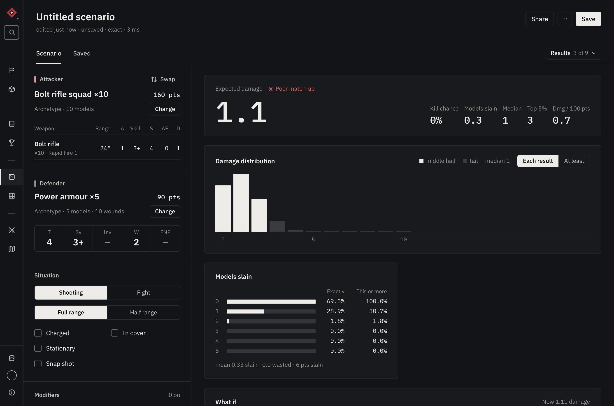
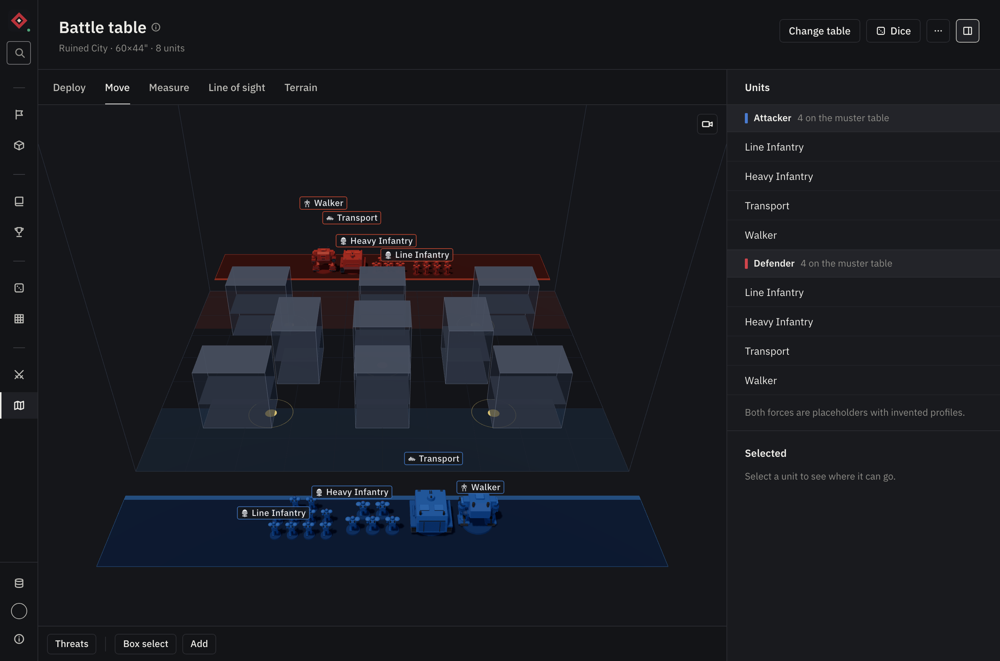
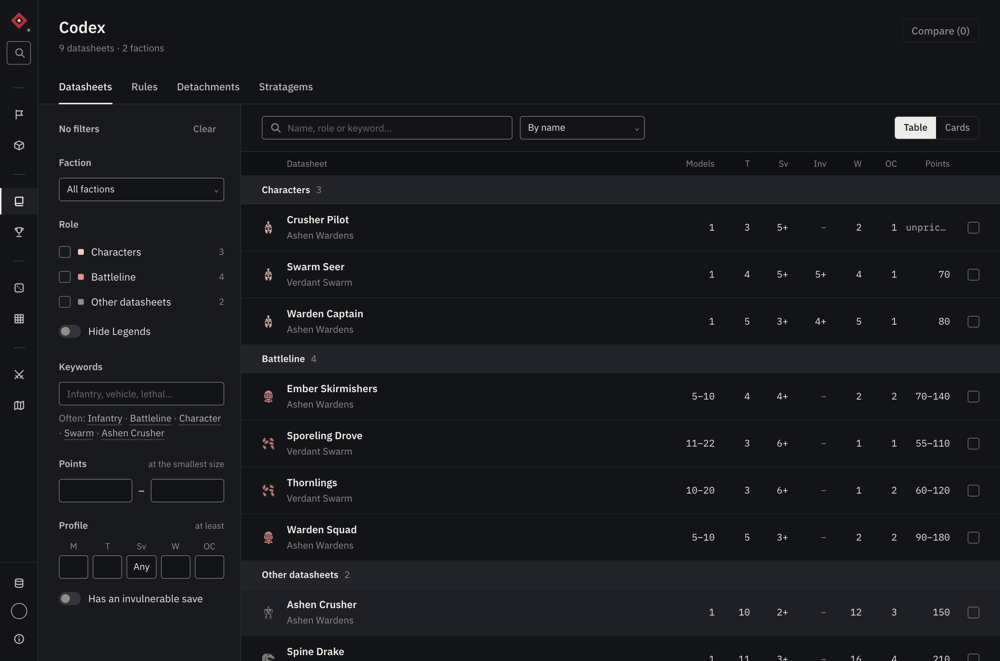

# Grimstat

Grimstat is an unofficial, fan-made statistics dashboard and army builder for Warhammer 40,000. It
runs in your browser and keeps everything you make on your own device.

Open it at [grimstat.com](https://grimstat.com). It is free, and you can use all of it without an
account. There is also an Android build of the same app.

## What it does

- The calculator works out what one unit does to another. It gives the whole probability
  distribution instead of a single average, so you see the chance of killing the target outright as
  well as the expected damage. It also gives models slain, damage per 100 points, and a what-if
  panel that ranks which single change moves the result most. Where an exact answer would take too
  long, it falls back to Monte Carlo.
- The army builder checks your list against the 11th-edition rules while you type. It checks
  Detachment Points, Leader and Support attachments, tiered unit costs, enhancements and transport
  capacity.
- The codex lays out every datasheet in your snapshot like a codex page. You can put two to six of
  them side by side, and the best value in each row is marked.
- The battle table is a 3D board. Line of sight is cast as rays between model hulls, measurement
  counts the vertical gap, and each model moves on its own across the terrain.
- The collection counts the models you own per datasheet. You can fill it in a box at a time from a
  catalogue of 223 boxed sets.
- The meta screen compares your army with the published tournament lists of its faction. It shows
  which units the field takes, where your list has more or fewer of them, and which lists yours is
  closest to.

The battle table below shows two deployment zones, terrain and a placeholder force on a 60×44" board.

The codex below shows every datasheet in the loaded snapshot, grouped by role.

Every screenshot uses the app's built-in sample data. The units and profiles in them are invented.
Loading your own snapshot replaces them.

## What is in this repository

The application source is private. This repository is the project's front page and the place to
report a fault. It also holds four parts of the code that run on their own.

[`engine/`](engine/) is the probability engine behind the calculator. It turns an attack sequence
into a full damage distribution, and it falls back to sampling when an exact solution would take too
long. It has no dependencies. `npm test` runs 51 tests, including property-based tests and Monte
Carlo runs checked against the exact solver.

[`analysis/`](analysis/) is the army-level maths built on the engine. It has the matchup matrix,
durability, the efficiency ranking, the what-if panel, the search for what removes a given unit, and
a whole-turn optimiser that spends command points. It does not read unit characteristics itself.
Its tests run every analysis over a made-up game to check that.

[`board/`](board/) is the geometry behind the battle table. It measures between models in three
dimensions, casts line of sight between model hulls through terrain, works out cover, and finds where
a model can move across the ground and up the floors of a ruin. It has no dependencies. `npm test`
runs 174 tests.

[`server/`](server/) holds the files the privacy notice makes claims about. They are every
migration, the purge job, sign-in, share links and the hashing. [`server/README.md`](server/README.md)
maps each sentence of the notice to the file it comes from, so you can check the retentions yourself.

## Reporting a fault

[Open an issue](https://github.com/N041M/Grimstat/issues) and include:

- what you did, what you expected, and what happened instead
- which screen it was on, and whether you were signed in
- the browser, and whether it is a phone, a tablet or a desktop.

Issues are public. If the fault involves your own army, describe the army instead of pasting an
export.

## Privacy

The privacy notice at [grimstat.com/#/privacy](https://grimstat.com/#/privacy) says what the server
holds, why, and for how long. The app keeps everything on your device and works without an account.
Signing in is optional. It copies what you have made to your other devices.

## Data

The app and this repository contain no Games Workshop rules text, datasheets, points or artwork.
The app has importers that fetch game data onto your own device from community sources. The sources
are BSData, the online Munitorum Field Manual and Wahapedia's CSV export.

The app also reads two public dataset repositories:

- [`grimstat-wahapedia`](https://github.com/N041M/grimstat-wahapedia) is a weekly copy of
  Wahapedia's own CSV export. The app imports Wahapedia's data from there, because a browser cannot
  read it from wahapedia.ru directly. It carries Wahapedia's attribution requirement: Powered by
  Wahapedia, https://wahapedia.ru.
- [`grimstat-corpus`](https://github.com/N041M/grimstat-corpus) holds published tournament lists. The
  meta screen compares your army with them.

Warhammer 40,000 and all associated marks are the property of Games Workshop Limited. This project is
not affiliated with, endorsed by, or sponsored by Games Workshop.

## Licence

Everything in this repository is under the [MIT licence](LICENSE). The licence does not cover the
Grimstat application, which is not published here. It does not cover anything that belongs to Games
Workshop.
